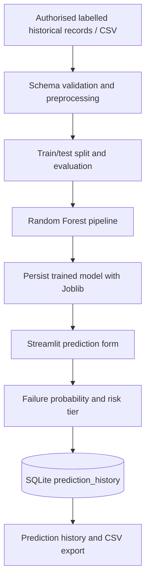

# System architecture

The included CSV is synthetic demonstration data. The app fits a Random Forest pipeline, reports hold-out metrics, and persists the fitted pipeline. A user-generated prediction is stored in SQLite with the input features, probability, risk tier, recommended action, model version, and timestamp.

Dataset-wide risk rankings are calculated separately and are not recorded as user-generated prediction history. Live sensors, direct BIT system integration, SHAP explanations, RUL estimation, email/SMS alerts, and automatic work-order dispatch are future extensions, not implemented features.
